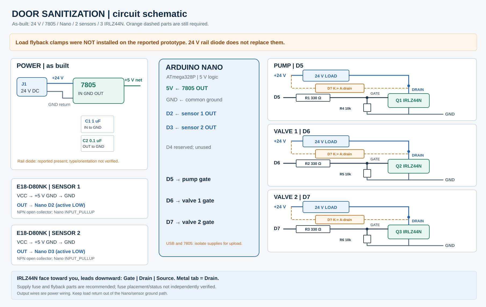

# Door Sanitization

Arduino Nano control board for a 24 V pump and two 24 V solenoid valves, triggered by two E18-D80NK proximity sensors. This repository records the **working prototype wiring and sketch reported by the builder**. The assistant has not independently tested the physical board.

## What is here

- DoorSanitization/DoorSanitization.ino — the final two-door sketch.
- docs/PROJECT_HANDOFF.md — project context and handoff notes for continuing without the original chat.
- docs/schematic.svg — circuit-level drawing with power, sensing and three MOSFET channels.
- docs/board-wiring.svg — practical connector and pin map.
- docs/wiring.md — full netlist, pinout and important distinctions between built and recommended components.
- docs/bom.md — component list and values.
- docs/test-and-troubleshooting.md — checks and the resolved RESET/upload issue.
- tools/render_diagrams.py — reproducible editable source for the SVG diagrams.

## Controller behavior

Each sensor has its own state machine. A clear reading for 200 ms arms its door. Detection held for 40 ms starts a 1-second valve pulse. That door then ignores triggers for 4 seconds after the pulse; it must clear again to rearm. The pump runs whenever either door is spraying. Two doors may run at the same time. At boot, a blocked sensor cannot start a pulse until it first clears.

The onboard Nano pin mapping is D2 sensor 1, D3 sensor 2, D5 pump, D6 valve 1 and D7 valve 2. D4 is reserved and has **no tank-level protection** in this firmware.

## Upload

Open DoorSanitization/DoorSanitization.ino in the Arduino IDE. Select Arduino Nano and the correct COM port. Use ATmega328P; if an older Nano clone requires it, try ATmega328P (Old Bootloader). The prototype initially failed to upload while in its socket because socket RESET/RST was shorted to GND (0.4 ohm with power removed). That short was found and repaired. If uploads fail again, check RESET on the unpowered empty socket before changing the sketch.

Disconnect 24 V and USB before removing/reinserting the Nano. Avoid powering the Nano from the 7805 and USB together until power-source isolation is designed and tested.

## Power and protection

The prototype uses a 7805 from 24 V to the Nano 5V pin, with 1 uF at its input and 0.1 uF at its output. The originally assembled board reportedly has a diode between 24 V and GND. **The pump and solenoid flyback diodes were not installed in the reported build.** This is an outstanding hardware issue: a single diode on the supply rail does not clamp each switched inductive load. Install a diode/clamp sized for each pump or valve before routine switching; orientation for a plain diode is cathode at load +24 V and anode at the MOSFET drain. Verify the pump motor and valve ratings before choosing the parts. An incorrectly oriented diode directly shorts the 24 V supply.

At 24 V input, a 7805 dissipates approximately (24 - 5) x output current as heat. For 100 mA, this is about 1.9 W. Check its real temperature under load and use a rated buck converter or suitable heatsinking for ongoing operation. The 7805 output must feed Nano 5V, not VIN. Never connect 24 V to Nano 5V, VIN, a sensor VCC, or a GPIO. Route pump/valve return currents directly to the supply common ground, not through a Nano pin or signal wiring.

See [the full wiring table](docs/wiring.md) before making changes. This prototype has no independent low-water shutoff, independent maximum-on timer, or feedback that a valve actually closed. Use contained water-only testing away from people.

## Sharing

No open-source license has been chosen for this prototype; the repository is currently for its owner's use.
