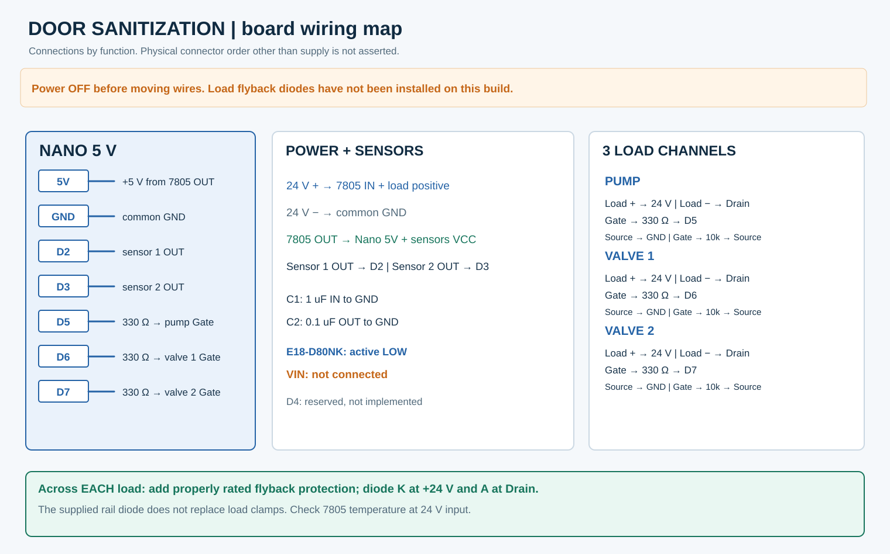

# Circuit wiring and netlist

This describes the reported working prototype. Connector designators are functional names for the diagram; they do not claim that the physical board has these printed labels. Check polarity with a DMM before connecting a 24 V load.

| Net | Connected parts |
| --- | --- |
| +24 V | Supply positive, 7805 IN, pump positive, valve 1 positive, valve 2 positive |
| GND | Supply negative, 7805 GND, Nano GND, both sensor GND pins, all three IRLZ44N Sources |
| +5 V | 7805 OUT, Nano 5V (not VIN), both sensor VCC pins |
| SENSE1 | Sensor 1 output to Nano D2 |
| SENSE2 | Sensor 2 output to Nano D3 |
| GATE_P | Nano D5 through 330 ohm to pump MOSFET Gate, Gate through 10 kohm to its Source |
| GATE_V1 | Nano D6 through 330 ohm to valve 1 MOSFET Gate, Gate through 10 kohm to its Source |
| GATE_V2 | Nano D7 through 330 ohm to valve 2 MOSFET Gate, Gate through 10 kohm to its Source |
| SW_P | Pump negative to pump MOSFET Drain |
| SW_V1 | Valve 1 negative to valve 1 MOSFET Drain |
| SW_V2 | Valve 2 negative to valve 2 MOSFET Drain |

The Nano uses INPUT_PULLUP on D2 and D3: clear is HIGH and detection is LOW. The E18-D80NK units were bench-tested as NPN open-collector active-LOW sensors. Common wire colours are brown VCC, blue GND, black output, but verify the marking on each sensor. Any later 24 V sensor replacement requires output-level verification/interface work before its output touches D2/D3.

## Power stage

- 24 V positive to 7805 IN; supply GND to 7805 GND.
- 1 uF across 7805 IN and GND; if electrolytic, positive goes to IN and choose a voltage rating above the actual supply including transients.
- 0.1 uF ceramic across 7805 OUT and GND, placed close to the regulator.
- 7805 OUT to Nano 5V pin and both sensor VCC connections; leave Nano VIN unconnected.
- Do not wire pump/solenoid return current through a breadboard, the Nano, or thin sensor ground traces. Bring power returns to the common supply negative point.
- The reported board has one diode across 24 V and GND. Its type and orientation have not been independently verified and it does not replace three load flyback clamps.

## Load channels (repeat three times)

With the IRLZ44N printed face toward you and leads pointing down, the usual TO-220 pin order is Gate / Drain / Source from left to right; metal tab is connected to Drain. Confirm your exact device/package marking before soldering.

1. Nano output D5, D6 or D7 to a 330 ohm series resistor, then to that MOSFET Gate.
2. 10 kohm from Gate to Source (gate held off when Nano is unpowered).
3. Source to common ground return; Drain to corresponding 24 V load negative.
4. Load positive to +24 V. The drawing shows individual load connectors.
5. **Outstanding protection:** place a suitable diode across each load, banded cathode at the load +24 V and anode at the switched load negative / Drain. This part is drawn dashed because it was not installed in the reported build. Choose type and ratings after measuring each load's current and determining acceptable solenoid release time. Pump motor switching may need a suitably rated suppression design.

A fuse sized to protect the wiring and load circuit is recommended on the 24 V input; whether a fuse exists on the reported board has not been established. A 24 V-to-GND rail diode must never be installed in a forward-biased orientation because that shorts the supply. Inspect its actual part and orientation separately.

